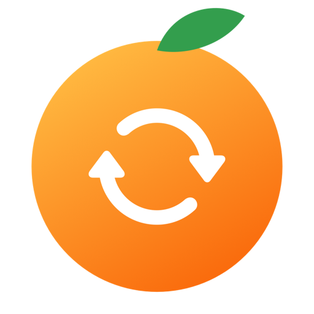
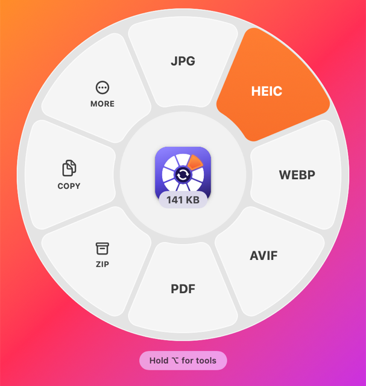
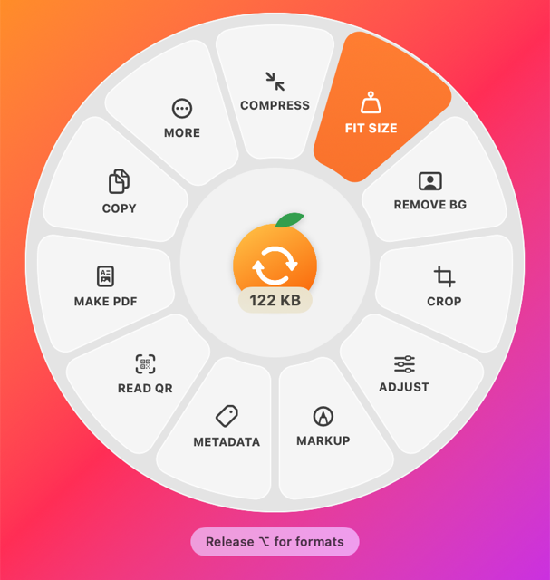

<p align="center"></p>

<h1 align="center">Elconvo</h1>

<p align="center"><b>Convert anything on your Mac by dragging it.</b><br>
Hold ⇧ while dragging a file and a wheel of formats opens around your pointer. Drop it on one. Done.</p>

<p align="center">
  <a href="https://github.com/eladitz/elconvo/releases/latest/download/Elconvo.dmg"><b>Download for Mac</b></a> ·
  <a href="https://ai.itzkin.com/elconvo.html">Website</a> ·
  <a href="https://ko-fi.com/eladitzkin">Support on Ko-fi ☕</a>
</p>

<p align="center">
  
  
</p>

Free, open source, and private: everything happens on your Mac. Files are never uploaded.
Works on Apple Silicon and Intel, macOS 14 Sonoma or later.

## How to use it

| Do this | And you get |
|---|---|
| **⇧ Shift + drag** any file, anywhere | A wheel of output formats around the pointer. Drop on one; the converted copy lands beside the original. |
| **⌥ Option + ⇧ Shift + drag** | The wheel fills with tools for that kind of file (compress, crop, trim, metadata…). Press or release ⌥ mid-drag to switch. |
| Drag **several files** or a **folder** | The centre shows their total size; tools like Join, Merge, Collage and Size & Info work on all of them at once. |
| Drop on **Copy** | The files go on the clipboard. Paste them anywhere with ⌘V. |
| Right-click in Finder ▸ **Services** | *Elconvo: Size & Info* and *Elconvo: Show Metadata*, no dragging needed. |
| Menu bar icon ▸ **Open Elconvo** | A batch window: drop in lots of files, pick formats, quality, size and output folder. |

Elconvo lives in the menu bar and offers to start at login, so the wheel is always there.

## What it converts

| Kind | To |
|---|---|
| **Images** (JPEG, PNG, HEIC, WebP, AVIF, TIFF, GIF, BMP, PSD, SVG, ICO, EXR…) | JPEG, PNG, HEIC, AVIF, WebP, TIFF, GIF, BMP, JPEG 2000, PSD, TGA, EXR, HDR, EPS, WBMP, SVG, ICO, ICNS, PDF |
| **RAW photos** (Sony, Canon, Nikon, Fuji, Olympus, Panasonic, Pentax, Leica, DNG…) | DNG, 16-bit TIFF/PNG, JPEG, HEIC, AVIF, WebP, PSD |
| **Audio** (MP3, WAV, AIFF, M4A, FLAC, OGG, Opus, WMA…) | M4A (AAC or Apple Lossless), MP3, WAV, AIFF, FLAC, CAF, AAC, OGG, Opus, WMA, MMF, iPhone ringtone (M4R) |
| **Video** (MP4, MOV, M4V, MKV, WebM, AVI…) | MP4, MOV (H.264 or HEVC), M4V, WebM, MKV, AVI, WMV, FLV, MPG, 3GP, 3G2, animated GIF, audio only |
| **Documents** (Word, RTF, HTML, Markdown, ODT, text) | PDF, DOCX, DOC, ODT, RTF, HTML, plain text, web archive |
| **PDF** (and Illustrator `.ai`) | Word (keeps headings, lists and **real tables**), images per page, text, RTF. Scanned pages are read with on-device OCR. |
| **3D models** (OBJ, STL, PLY, 3MF, USDZ, USD, Alembic) | STL, 3MF, OBJ, PLY, USDZ, USDA |
| **Subtitles** | SRT ↔ WebVTT, plain text |
| **Data** | JSON ↔ CSV ↔ TSV ↔ Property list |
| **Archives** (ZIP, 7z, RAR, TAR, GZ, BZ2, XZ, ISO, CAB…) | Extract, or pack any files and folders into ZIP, 7z, TAR.GZ, TAR.XZ, TAR.BZ2, TAR |

## Tools (⌥⇧-drag)

- **Compress** and **Fit Size**: shrink images, video, audio and PDFs, or aim for an exact size ("2 MB").
- **Crop** (photos and video), **Adjust** (exposure, contrast, saturation, warmth, highlights, shadows, sharpness, vignette, rotate, flip), **Markup** (pen, arrows, boxes, text, pixelate, black-out, auto-redact faces and text).
- **Remove background** from photos and from **video** (people and animals): transparent `.mov`, blurred background, or green screen, with the sound kept.
- **Read QR / barcodes**, **Make PDF** and **Collage** from images.
- **Trim, Snapshot, Split** video and audio; **2× / ½ speed**, **Mute**, **Join**; audio **Normalize**, **Mono / Stereo**.
- **PDF**: **Organize** pages (drag to reorder, rotate, delete), **Split**, **Rotate**, **Merge**.
- **Metadata**: read everything (GPS location is flagged), edit title / author / copyright / description / keywords, or strip it all.
- **Rename** and **Batch Rename**: rename one file, or many at once (replace text, add text, name + number, change case) with a live before → after preview.
- **Size & Info**: true size of files and folders, largest first, plus MD5 / SHA-1 / SHA-256 / SHA-512 / CRC-32 checksums with a paste-to-verify box.

Edits are always saved as a new file beside the original, never over it. The one exception is the metadata editor's **Save Changes**, which writes the new tags into the file itself.

## Install

1. [Download Elconvo.dmg](https://github.com/eladitz/elconvo/releases/latest/download/Elconvo.dmg), open it and drag **Elconvo** into **Applications**.
2. The app isn't signed with an Apple Developer ID yet, so the first time you open it macOS will refuse. Go to **System Settings ▸ Privacy & Security**, scroll down and click **Open Anyway**. You only do this once.
3. Say yes to *Open at Login* so the wheel is always available.
4. When it offers **Full Disk Access**, click **Open Settings** and switch Elconvo on (Touch ID). That one switch replaces the separate prompts for Desktop, Documents, Downloads, iCloud Drive and every USB drive. Later: menu bar icon ▸ Grant Full Disk Access.

### Optional extras (free)

Elconvo uses what comes with macOS. A few formats light up when these are installed:

| Install | Unlocks |
|---|---|
| `brew install ffmpeg` | MP3, OGG, Opus, WMA, MMF; WebM, MKV, AVI, WMV, FLV, MPG, 3GP; exact-size video |
| `brew install imagemagick` | WebP, HDR, EPS, WBMP output |
| [Adobe DNG Converter](https://helpx.adobe.com/camera-raw/using/adobe-dng-converter.html) | RAW → DNG |

Restart Elconvo after installing them.

**A note on RAW → RAW:** no tool can turn a Sony ARW into a Canon CR3 or Nikon NEF. Those formats are closed and only cameras write them. DNG is the open RAW format that Lightroom, Photoshop, Capture One and Apple Photos all read, and it keeps the full RAW data.

## Build from source

Needs only the Xcode Command Line Tools (`xcode-select --install`), no Xcode.

```sh
./build.sh      # builds build/Elconvo.app (Apple Silicon + Intel)
./package.sh    # builds and wraps it in build/Elconvo.dmg
```

`package.sh` signs and notarizes the DMG when `DEVELOPER_ID` and `NOTARY_PROFILE` are set (see the script).

The app also has a command-line mode, handy for scripts:

```sh
Elconvo.app/Contents/MacOS/Elconvo --convert photo.heic jpg
Elconvo.app/Contents/MacOS/Elconvo --tool compress video.mov
```

| File | What's in it |
|---|---|
| `Sources/main.swift` | Formats, the conversion engine, the batch window, app shell |
| `Sources/Wheel.swift` | The drag wheel and progress windows |
| `Sources/Tools.swift` | The ⌥⇧ tools, crop / trim / metadata windows |
| `Sources/Studio.swift` | Size & Info, Adjust, Markup, PDF organizer, metadata editing, 3D |
| `Sources/PDFWord.swift` | PDF → Word that keeps headings, lists and tables |
| `Sources/VideoMatte.swift` | Video background removal |
| `Sources/Rename.swift` | Rename and Batch Rename |
| `Sources/Donate.swift` | The once-a-month "enjoying it?" note |

## Support

Elconvo is free and made by one person. If it saves you time, a coffee on **[Ko-fi](https://ko-fi.com/eladitzkin)** keeps it going. The app asks once a month whether you like it, and stops asking for a year if you've donated.

Made by Elad Itzkin · [ai.itzkin.com](https://ai.itzkin.com) · [elad.itzkin.com](https://elad.itzkin.com). MIT licensed.
